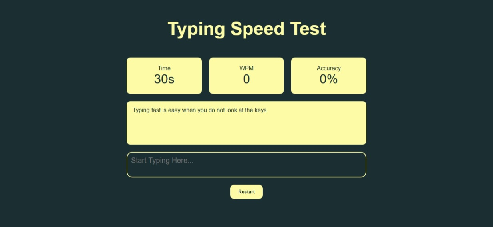

# Typing Speed Test

A simple typing speed test that runs in the browser. Type the sentence shown on screen and see your speed and accuracy update live.

**Live demo:** https://ayandev-developer.github.io/typing-speed-test/



## Features

- 30-second countdown timer that starts on the first key press
- Live WPM (words per minute)
- Live accuracy percentage
- Each character turns green when correct and red when wrong
- Random sentence on every load
- Restart button that resets everything and loads a new sentence

## Built with

- HTML
- CSS (flexbox layout, CSS variables)
- JavaScript (DOM, events, `setInterval`, no frameworks)

## How WPM is calculated

```
WPM = (correct characters / 5) / minutes elapsed
```

Five characters count as one word.

## About this project

Design and layout built by me. JavaScript written while learning, with AI guidance.

## Run locally

1. Download or clone this repository.
2. Open `index.html` in your browser.

## Author

Ayan - [GitHub](https://github.com/ayandev-developer)
